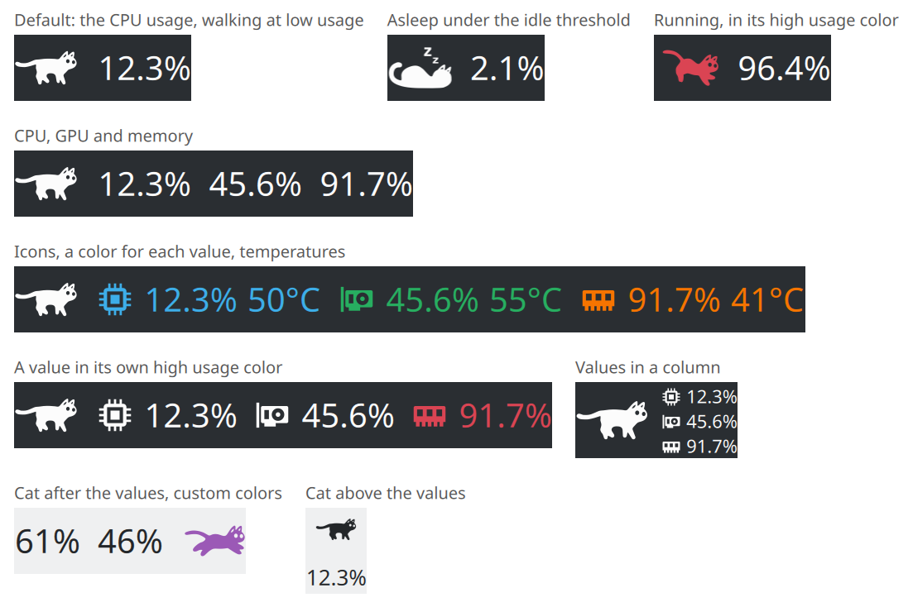
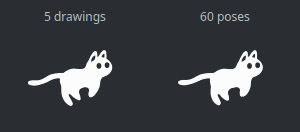
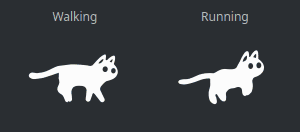

# CatWalk Monitor

A system monitor for the KDE Plasma panel, in the shape of a cat: it sleeps
when nothing happens, walks when little does, and runs faster and faster as
the computer gets busy.



## Features

- **CPU, GPU and memory usage**, one of them or all three at once, each with
  its **temperature** if wanted. The CPU usage alone is the default.
- **A smooth cat.** It is drawn at a constant frame rate whatever its speed,
  going through sixty poses computed from the five original drawings, where
  the original widget flipped through those five.

  

- **Two gaits.** At low usage the cat walks, one paw after the other,
  instead of running in slow motion.

  

- **The cat follows what you choose**: the CPU, the GPU, the memory, the
  highest of the selected values or their average. The usage under which
  it sleeps and the one under which it walks can be set.
- **Colors**: one for the cat, one for the values, and one for each value if
  wanted. Everything follows the theme by default. The cat and each value
  can also change color above a usage of their own.
- **Layout**: cat before, after, above or below the values; values in a row
  or in a column; icons in front of the values; spacing between the
  elements and before the temperatures; sizes of the cat and of the text,
  chosen automatically from the panel by default.
- Works in horizontal and vertical panels and on the desktop, and stays
  sharp on scaled displays.

With the cat alone, the selected values are listed in its tooltip.

Temperatures are the average over the cores for the CPU, over the cards for
the GPU and over the modules for the memory. The last one needs memory
modules with a temperature sensor, which is common with DDR5 and rare before.

## Installation

Requires KDE Plasma 6.

```sh
git clone https://github.com/Gerem66/CatWalkMonitor.git
cd CatWalkMonitor
kpackagetool6 --type Plasma/Applet --install package
```

Then add *CatWalk Monitor* to a panel or to the desktop from
*Add or Manage Widgets…*.

To update an existing installation, from the same directory:

```sh
git pull
kpackagetool6 --type Plasma/Applet --upgrade package
systemctl --user restart plasma-plasmashell
```

The last command matters: a running Plasma keeps the previous version of
the widget in memory. Without it, the settings page is the new one but the
widget, its translations and the list of its settings are still the old
ones, so new settings show in English and are not saved.

To remove it:

```sh
kpackagetool6 --type Plasma/Applet --remove com.github.gerem66.catwalkmonitor
```

The package can also be installed with CMake, which needs no compiler:
`cmake -B build && cmake --install build --prefix ~/.local`.

## Development

The widget is plain QML, in `package/`. Two files in it are generated and
committed, so that installing needs no build step:

- `package/contents/images/cat.svg`, the sprite sheet holding every pose of
  the cat. It is built by `tools/generate_sprites.py`, which only needs
  Python 3, from the drawings in `art/`: five keyframes for the run
  (`run-*.svg`), five for the walk (`walk-*.svg`) and the sleeping cat. The
  poses in between are interpolated. Run it again after changing a
  drawing; if a paw has moved, update its position at the top of the
  script, where the interpolation is pinned.

  The keyframes of the run are the original artwork. Those of the walk,
  which the original does not have, were first drawn by
  `tools/draft_walk.py` from the body of one of them. They are drawings
  like the others: retouch them in a vector editor, or run that script
  again with `--force` to draw them anew with other proportions.
- `package/contents/locale/`, the compiled translations. The catalogs are
  in `translations/`; `translations/build.sh` extracts the strings, updates
  the catalogs and compiles them. It needs gettext. To start a translation,
  copy `translations/template.pot` to `<language>.po` and run the script.

The widget is translated into French, Arabic, Russian and Ukrainian. The
last three have not been reviewed by native speakers; corrections are
welcome.

To try a change without touching the installed widget:

```sh
kpackagetool6 --type Plasma/Applet --upgrade package   # or --install the first time
plasmawindowed com.github.gerem66.catwalkmonitor
```

## Credits

CatWalk Monitor is a fork of
[CatWalk Neo](https://github.com/SpinningVinyl/CatWalkNeo) by Pavel Urusov,
itself based on the CatWalk plasmoid by Yuri Saurov
([Plasma 6](https://store.kde.org/p/2137844/),
[Plasma 5](https://store.kde.org/p/2055225/)). The history of both projects
is kept in this repository.

The cat was drawn by Takuto Nakamura for [RunCat](https://github.com/Kyome22/menubar_runcat)
(Apache License 2.0); these drawings very likely came to CatWalk through the
[RunCat GNOME extension](https://github.com/win0err/gnome-runcat) by Sergei
Kolesnikov (GPL-3.0). The poses in between and the walk are computed from
them.

## License

CatWalk Monitor is free software: you can redistribute it and/or modify it
under the terms of the GNU General Public License as published by the Free
Software Foundation, either version 3 of the License, or (at your option)
any later version. See [LICENSE](LICENSE).

CatWalk and CatWalk Neo are distributed under the GNU General Public License,
version 2 or any later version; this fork uses version 3, the one that is
compatible with the licenses of the artwork.
